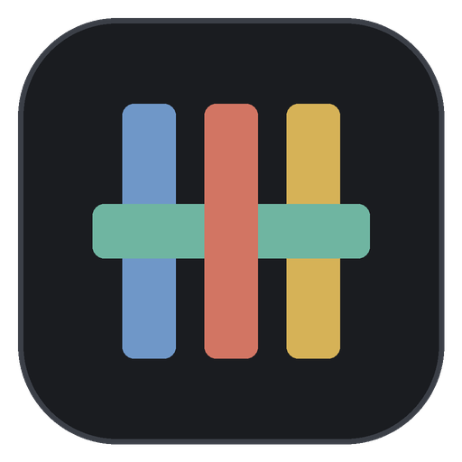

<p align="center">
  
</p>

<h1 align="center">Loom</h1>

<p align="center">
  One window for all your projects and their Claude Code chats.<br>
  Chats, files, terminals, dev servers and git from every project, side by side.
</p>

<p align="center">
  
</p>

## Why

If you work on several projects with Claude Code, you probably end up with a VS Code window per project, each with its own chat, terminal and dev server, and a lot of Alt+Tab. Loom puts them in one place. Every project sits in a sidebar, every tab (a chat, a file, a terminal, a running site) shares one tab bar no matter which project it belongs to, and every chat runs in its own project's folder.

It is built on the Claude Agent SDK, so it is Claude Code underneath: your sign-in, settings, `CLAUDE.md`, skills, hooks and chat history all carry over. Chats you started in the terminal or in VS Code show up in Loom, and the other way round.

## What it does

### Chats that read like a timeline

Your message, then a thread of Claude's steps: commands and edits show what went in and what came out, reads and searches open on a click, and every step says how long it took. Pick the model, permission mode and effort per chat; new chats start with whatever you picked last. Approve or deny tool use inline, attach images, type `/` for every command and skill Claude has in that folder, and watch a small meter for how full the chat is getting. Any earlier Claude Code chat for a project can be picked up where it left off.

### Run the project and see it beside the chat

Loom reads each project's `package.json` for `dev`, `start`, `serve` and similar scripts and turns them into a Run button in the chat header, using the project's own npm, pnpm, yarn or bun. Running servers are listed in the status bar with restart and stop, and their address opens in a preview pane next to the chat, with phone and tablet widths and developer tools. Quitting Loom stops everything it started.

### Lay it out however you like

<p align="center">
  
</p>

Side by side, top and bottom, three columns or four squares. Drag a tab onto a pane to show it there or onto an edge to split, drag the dividers to resize, and move any tab out to a window of its own for another screen. Chats keep running and terminals keep their output while they move. The layout is saved.

### Git without leaving the chat

<p align="center">
  
</p>

See what changed, open a side-by-side diff, stage or throw away changes (Loom keeps a copy), and commit only the files you select. Write the message yourself or let Claude write it, following the commit rules in your `CLAUDE.md`. Push, pull, switch or start branches and browse recent commits. The sidebar marks which projects are in git and whether anything is waiting to commit, push or pull.

### Projects, files and terminals

Group projects in the sidebar; each one picks up its site's favicon. A group can watch a folder: when new folders appear there (after a git pull, say), the group offers them with one click to add. Open and edit files in the same editor as VS Code (Monaco), find any file with Ctrl+P, and open a terminal (PowerShell, Command Prompt or Git Bash) in any project folder. A chat can move to another project, history and all.

### A short first run

<p align="center">
  
</p>

The first launch walks through signing in to Claude, adding projects (it suggests the folders you have already used with Claude Code), and choosing how much Claude may do without asking. It takes about two minutes and can be skipped.

## Install

Download `Loom-Setup-<version>.exe` from the [latest release](../../releases/latest) and run it. Install it for just you (no admin needed) or everyone on the PC, in the folder you like; it adds Loom to the Start menu and the desktop.

Loom keeps itself up to date. When a new version is out it downloads it in the background and shows a **Restart to update** button in the status bar; Loom reopens in a few seconds with your tabs and chats. Ignore it and the update installs the next time you quit. Settings has the version, Check for updates and What's new.

Loom isn't code-signed yet, so the first time Windows may say "Windows protected your PC". Click **More info**, then **Run anyway**.

You also need:

- **Claude Code**, Anthropic's command-line tool, with a Claude account that can use it. If it isn't on your PC, Loom's first-run steps install it for you with Anthropic's own installer.
- **[Git](https://git-scm.com)**, for the git features.

Loom is made for Windows 11. Windows 10 should work but is untested.

### Build it yourself

With [Node.js](https://nodejs.org) 20 or newer:

```
git clone https://github.com/panosmg13gr/loom.git
cd loom
npm install
npm run build
npm start
```

A copy built this way runs the Claude Code that `npm install` brings along (or your own, in Settings), adds its own Loom shortcut to the desktop and the Start menu on the first launch, and updates with `git pull` and `npm run build`.

## Shortcuts

| | |
|---|---|
| New chat in this project | Ctrl+T |
| Close tab | Ctrl+W |
| Next and previous tab | Ctrl+Tab, Ctrl+Shift+Tab |
| Open a file | Ctrl+P |
| New terminal | Ctrl+` |
| Split to the right, split down | Ctrl+\, Ctrl+Shift+\ |
| Move between panes | Ctrl+Alt+arrows |
| Sidebar | Ctrl+B |
| Files, Git and Claude panel | Ctrl+Alt+B |
| Settings | Ctrl+, |
| Stop Claude | Esc in the message box |
| Save a file | Ctrl+S |

## Good to know

- **Your data stays where it was.** Chat history stays in `~/.claude/projects`, where Claude Code keeps it. Loom's own state (projects, groups, open tabs, settings) is in `%APPDATA%\Loom\loom-state.json`.
- **One chat, one app at a time.** Don't continue the same chat in VS Code and Loom at once: both write to the same history file.
- **Resumed chats** show their messages from the last compaction onward, like Claude Code does. Earlier turns are summarized in the first message.
- **Plan limits** in the status bar come from the same source as Claude Code's `/usage`. The SDK marks that call experimental; if it changes, the meter stops updating and nothing else breaks.
- **Previews are sandboxed.** Sites in a preview pane run with no access to Loom.
- **Moving a chat** to another project moves its history file to that project's folder and keeps the original in `~/.claude/chat-backups`.
- **Throwing away changes** in the Git panel keeps a copy in `%APPDATA%\Loom\discarded`; new files go to the Recycle Bin.

## Working on Loom

```
npm run dev          # run with live reload
npm run typecheck
npm run smoke        # opens the built app with a scratch profile and checks the main features
npm run smoke:live   # also sends two tiny messages to Claude (Haiku) and tests approvals
npm run dist         # builds the installer into dist/
```

`smoke:live` leaves two short test chats in Claude's history for this folder. To also check that one of your own saved chats loads, set `LOOM_SMOKE_CHAT="<folder>|<session id>"`. `LOOM_USER_DATA=<folder>` runs a second, separate Loom with its own profile.

To release a version, run `npm version patch` (or `minor`), then `git push --follow-tags`. The Release workflow builds the installer and attaches it to a draft release on GitHub; check it there and publish it. Installed copies find it within a few hours (or at once with Check for updates) and offer Restart to update.

Loom is Electron, React and TypeScript, built with electron-vite and packaged with electron-builder. Chats go through the [Claude Agent SDK](https://www.npmjs.com/package/@anthropic-ai/claude-agent-sdk), files open in Monaco, and terminals are xterm.js on a native pty.

## Status

Loom is a personal tool, shared as it is. It is used every day on Windows 11; other systems are untested. Version 0.1, so expect rough edges.

Loom is an independent project. It is not made by or affiliated with Anthropic. Claude and Claude Code are trademarks of Anthropic.

## License

[MIT](LICENSE)
