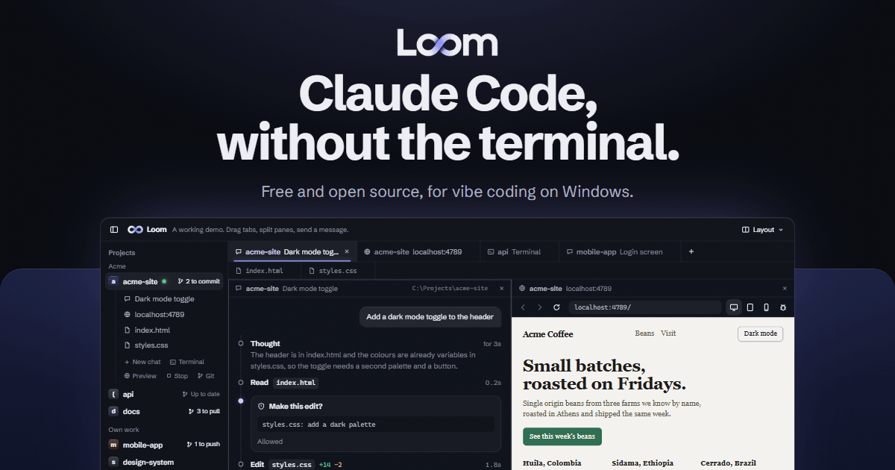
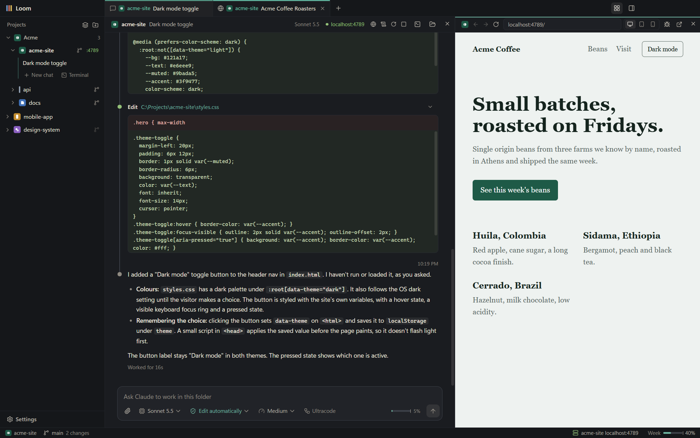
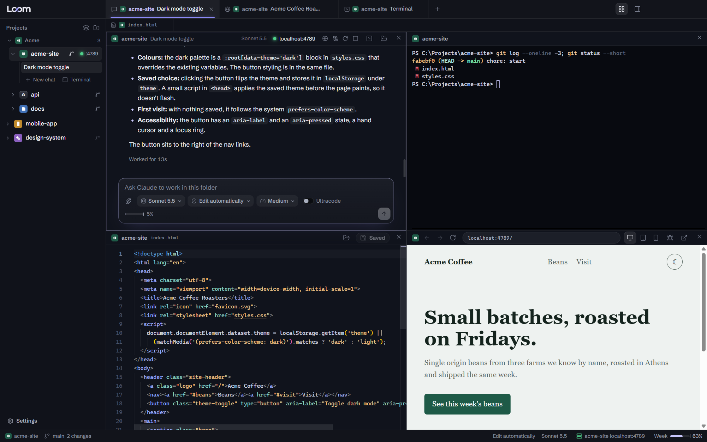
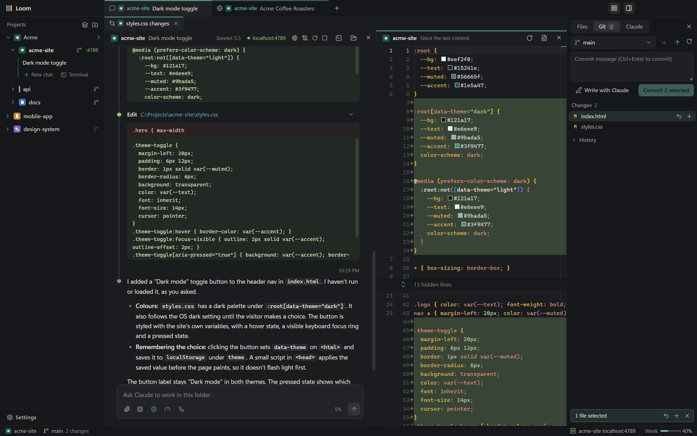
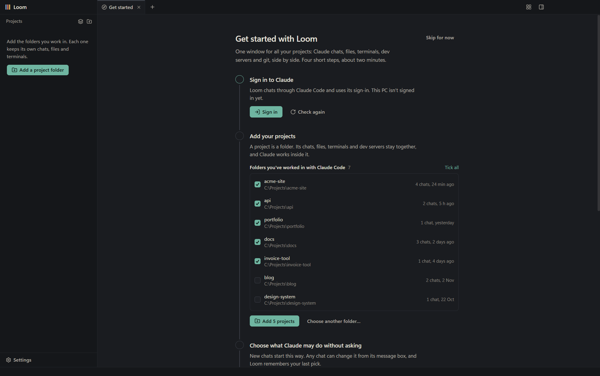

<p align="center">
  <a href="https://loom.baby">
    
  </a>
</p>

<p align="center">
  <a href="https://github.com/PixFrixSystems/loom/releases/latest"></a>
  <a href="LICENSE"></a>
  
</p>

<p align="center">
  <a href="https://github.com/PixFrixSystems/loom/releases/latest"><b>Download for Windows</b></a>
  &emsp;
  <a href="https://loom.baby">Website</a>
  &emsp;
  <a href="https://remote.loom.baby">Loom on your phone</a>
  &emsp;
  <a href="https://github.com/PixFrixSystems/loom/issues">Report a problem</a>
</p>

Loom is a free, open-source desktop app for Windows that puts Claude Code in a chat window, with your running site, your files, a terminal and git beside it. Chat with Claude, approve changes with a click and watch your site update next to the chat. Just the tools you use, none of the bloat.

It is Claude Code underneath, built on Anthropic's Claude Agent SDK. Your sign-in, settings, `CLAUDE.md`, skills, hooks and chat history all carry over, and chats you started in the terminal show up in Loom, and the other way round.

<p align="center">
  
</p>

## Loom next to the terminal

The same Claude, in a friendlier place.

| | Loom | Claude Code in a terminal |
|---|---|---|
| Following along | A timeline: each step with its time and what changed | Text scrolling past as Claude works |
| Approving changes | Allow or Deny on a card that shows the change | Answering prompts in the terminal |
| Seeing your site | Click Run and the site opens next to the chat | Start a dev server, open a browser, switch back and forth |
| Several projects | One sidebar; every chat already runs in its project's folder | A terminal per project, and `cd` to the right folder |

## What's in it

Just enough IDE: a chat in the middle, and around it only the tools you reach for.

### Chats that read like a timeline

Your message, then a thread of Claude's steps. Commands and edits show what went in and what came out, reads and searches open on a click, and every step says how long it took. Approve or deny an edit on a card, attach images, type `/` for every command and skill Claude has in that folder, and watch a small meter for how full the chat is getting. Pick the model, permission mode and effort per chat; new chats start with whatever you picked last. Any earlier Claude Code chat for a project can be picked up where it left off.
Once your message scrolls out of sight it stays pinned at the top of the chat, with arrows to step through your messages, so you always know which question the answer on screen belongs to.
Type `/usage` at any time, even while Claude works, to see your plan limits.

Heavy jobs don't have to hold up the chat. A long command or agent can be moved to the background from its step with **Run in background**, and **Send to background** (Alt+Enter) hands a new job straight to a background agent. Either way you keep chatting; when the job is done Loom says so, and Claude picks up the result and carries on. Stop ends Claude's turn and leaves background work running; each job has its own Stop.

### Run the project and see it

Loom reads each project's `package.json` for `dev`, `start`, `serve` and similar scripts and turns them into a Run button in the chat header, using the project's own npm, pnpm, yarn or bun. The site opens in a preview pane next to the chat, with phone and tablet widths and developer tools. Running servers are listed in the status bar with restart and stop, and quitting Loom stops everything it started.

### Split it the way you work

<p align="center">
  
</p>

Side by side, top and bottom, three columns or four squares. Drag a tab onto a pane to show it there or onto an edge to split, drag the dividers to resize, and move any tab out to a window of its own for a second screen. Chats keep running and terminals keep their output while they move. The layout is saved.

### Git without leaving the chat

<p align="center">
  
</p>

See what changed, read a side-by-side diff, stage or throw away changes (Loom keeps a copy), and commit only the files you select. Write the message yourself or let Claude write it, following the commit rules in your `CLAUDE.md`. Push, pull, switch or start branches and browse recent commits. The sidebar marks which projects are in git and whether anything is waiting to commit, push or pull.

### One sidebar, one tab bar, every project

Every project sits in the sidebar, and every tab (a chat, a file, a terminal, a running site) shares one tab bar, whichever project it belongs to. Group projects; each one picks up its site's favicon. A group can watch a folder: when new folders appear there, the group offers them with one click to add. Open and edit files in Monaco, find any file or chat with Ctrl+P, and open a terminal (PowerShell, Command Prompt or Git Bash) in any project folder. A chat can move to another project, history and all.

### Your chats on your phone

Link a phone in Settings, Phone access: Loom shows a QR code, the phone scans it, and Loom asks you on the PC whether to let it in, with the same four digits on both screens. From then on [remote.loom.baby](https://remote.loom.baby) on that phone shows your projects and their chats. Follow a chat as Claude writes, send messages and pictures, stop it, pick its model and effort, and answer its approvals, questions and plans, from anywhere. Loom has to be running on the PC, which still does all the work.

The phone and the PC talk through a small relay, and everything between them is encrypted with a key only the two hold: the relay passes sealed messages along and cannot read them. Phone access is off until you link a phone, each phone can be removed in Settings, and the status bar says when one is connected. The page can be added to the phone's Home Screen; link that copy with the Scan the code button inside it. How it works is written up in [remote/README.md](remote/README.md).

### Left out on purpose

No extension store, no wall of settings, no debugger setups, no menus inside menus. For anything bigger, open the file in the editor you like; Loom works fine next to it.

## Get started

Download `Loom-Setup-<version>.exe` from the [latest release](https://github.com/PixFrixSystems/loom/releases/latest) and run it. Install it for just you (no admin needed) or for everyone on the PC, in the folder you like. It adds Loom to the Start menu and the desktop. Loom is about 120 MB and is made for Windows 11; Windows 10 should work but is untested.

You also need:

- **A Claude account that can use Claude Code:** a Claude plan or an Anthropic Console account. Loom has no account of its own and needs no API key.
- **Claude Code**, Anthropic's command-line tool. If it isn't on your PC, Loom's first-run steps install it for you with Anthropic's own installer.
- **[Git](https://git-scm.com)**, for the git features.

<p align="center">
  
</p>

The first launch walks through signing in to Claude, adding projects and choosing how much Claude may do without asking. If you already use Claude Code, it lists every folder you have used it in: tick them, click Add, and your projects arrive with their chats. It takes about two minutes and can be skipped.

### Use an external agent

Loom can also run a local CLI that supports the `app-server` protocol over standard input and output. Install the CLI and open **Settings → Chat agents** to select its Windows `.exe` if Loom does not detect it. Use **Settings → Accounts** to sign in when the build includes browser sign-in for that agent. Other agents use their CLI sign-in. Choose a default under **Agent for new chats**, or use **Chat agent** in an empty chat. Existing chats keep the agent that created them.

External chats use the selected CLI's account and local history. **Read-only** starts with read-only access. **Edit workspace** lets the agent edit the project and request approval for work beyond its sandbox. **Plan mode** produces a plan with read-only access on supported CLI versions. Type `$` in the message box to look up installed skills. Start a new chat in the target folder to work on a different project.

**Updates.** Loom keeps itself up to date. A new version downloads in the background and a **Restart to update** button appears in the status bar; Loom closes, installs it and opens again by itself, with your tabs and chats, usually within a minute. Ignore it and the update installs the next time you quit. Settings has the version, Check for updates and What's new.

**The Windows warning.** Loom isn't code-signed yet, so the first time you run the installer Windows may say "Windows protected your PC". Click **More info**, then **Run anyway**.

## Where your code and chats go

- **To Claude, through Claude Code, exactly as with the CLI.** Loom has no account, no analytics and no server of its own for your work.
- **Chat history stays on your PC,** in `~/.claude/projects`, where Claude Code keeps it. Loom's own state (projects, groups, open tabs, settings) is in `%APPDATA%\Loom\loom-state.json`.
- **GitHub is contacted to check for updates,** and for nothing else.
- **A linked phone goes through a relay that cannot read it.** What passes between the phone and the PC is sealed with a key only the two hold. The phone's key lives in its browser, where the page can use it but not read it, and on the PC it is encrypted for your Windows account. A linked phone can do what you can in a chat, including approving what Claude asks to run, so remove a lost phone in Settings, Phone access.
- **Previews are sandboxed.** A site in a preview pane runs with no access to Loom.
- **Settings, Accounts shows who this PC is signed in as:** your Claude account, and GitHub, Cloudflare and Vercel as their own tools have them. That is what a push or a deploy from a terminal or from Claude goes out as. Loom reads the names and keeps nothing.

## Shortcuts

| | |
|---|---|
| New chat in this project | Ctrl+T |
| Close tab | Ctrl+W |
| Next and previous tab | Ctrl+Tab, Ctrl+Shift+Tab |
| Open a file or a chat | Ctrl+P |
| New terminal | Ctrl+` |
| Split to the right, split down | Ctrl+\, Ctrl+Shift+\ |
| Move between panes | Ctrl+Alt+arrows |
| Sidebar | Ctrl+B |
| Files, Git and Claude panel | Ctrl+Alt+B |
| Settings | Ctrl+, |
| Stop Claude | Esc anywhere in the chat |
| Save a file | Ctrl+S |

## Good to know

- **One chat, one app at a time.** Don't continue the same chat in Loom and somewhere else at once: both write to the same history file.
- **Resumed chats** show their messages from the last compaction onward, like Claude Code does. Earlier turns are summarized in the first message.
- **Plan limits** in the status bar come from the same source as Claude Code's `/usage`. The SDK marks that call experimental; if it changes, the meter stops updating and nothing else breaks.
- **Moving a chat** to another project moves its history file to that project's folder and keeps the original in `~/.claude/chat-backups` for 30 days (Settings changes how long).
- **Throwing away changes** in the Git panel keeps a copy in `%APPDATA%\Loom\discarded`; new files go to the Recycle Bin.

## For developers

Loom is Electron, React and TypeScript, built with electron-vite and packaged with electron-builder. Chats go through the [Claude Agent SDK](https://www.npmjs.com/package/@anthropic-ai/claude-agent-sdk), files open in Monaco, and terminals are xterm.js on a native pty.

### Build it yourself

With [Node.js](https://nodejs.org) 20 or newer:

```
git clone https://github.com/PixFrixSystems/loom.git
cd loom
npm install
npm run build
npm start
```

A copy built this way runs the Claude Code that `npm install` brings along (or your own, in Settings), adds its own Loom shortcut to the desktop and the Start menu on the first launch, and updates with `git pull` and `npm run build`.

### Work on it

```
npm run dev          # run with live reload
npm run typecheck
npm run smoke        # opens the built app with a scratch profile and checks the main features
npm run smoke:live   # also sends two tiny messages to Claude (Haiku) and tests approvals
npm run dist         # builds the installer into dist/
```

`smoke:live` leaves two short test chats in Claude's history for this folder. To also check that one of your own saved chats loads, set `LOOM_SMOKE_CHAT="<folder>|<session id>"`. `LOOM_USER_DATA=<folder>` runs a second, separate Loom with its own profile.

The phone page and its relay live in `remote/` and run as one Cloudflare Worker: `remote/app` is the page, `remote/worker` the relay, and `src/shared/remote.ts` holds the messages and the encryption both sides share. See [remote/README.md](remote/README.md).

For a packaged build, place `agent-profile.json` in the repository's `resources/` directory before building. Builds that supply it beside `app.asar` are also supported. Use `LOOM_AGENT_PROFILE` to point a source build at a profile. Set `name` and `accountName` for the labels, `executable` and optionally `installDirectory` relative to Windows local app data for detection, and `loginType` and `loginOrigins` for managed browser sign-in. `installUrl` can point to the agent's installation instructions.

### Release a version

Run `npm version patch` (or `minor`), then `git push --follow-tags`. The Release workflow builds the installer and attaches it to a draft release in this repository; check it there and publish it. Installed copies find it within a few hours, or at once with Check for updates, and offer Restart to update. Every copy of Loom looks for updates in this repository.

## Questions and problems

The [website](https://loom.baby) answers the common questions. For a bug or an idea, [open an issue](https://github.com/PixFrixSystems/loom/issues).

Loom is at version 0.1 and is used every day on Windows 11, so expect it to keep changing.

## License

[MIT](LICENSE). Loom is made by [PixFrix](https://pixfrix.gr/).

Loom is an independent project built on Anthropic's Claude Agent SDK. It is not made by or affiliated with Anthropic; Claude and Claude Code are trademarks of Anthropic. It is also not related to Atlassian's Loom video tool, or to any other product with the same name.
